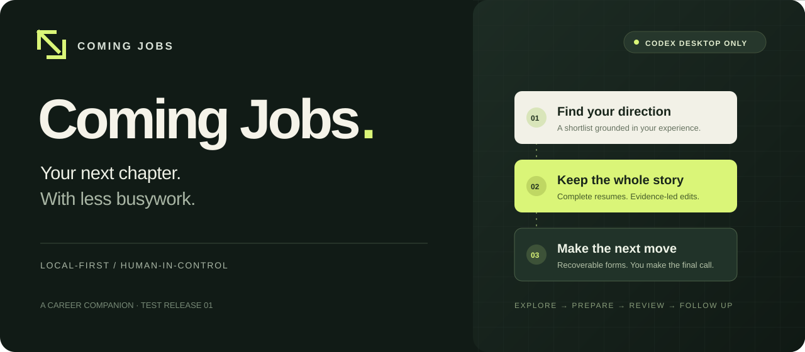
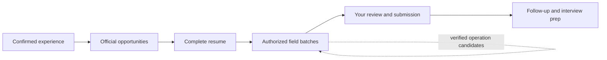

<p align="center"></p>

<p align="center">
  <a href="README.zh-CN.md">简体中文</a> · <b>English</b><br>
  <a href="https://github.com/Dream-of-July/Coming-Jobs/releases/tag/v1.0.0-beta.10">Download the test release</a> ·
  <a href="docs/INSTALL.md">Install</a> ·
  <a href="docs/TESTING.md">What's tested</a> ·
  <a href="https://github.com/Dream-of-July/Coming-Jobs/issues/new/choose">Feedback</a>
</p>

<p align="center">
  
  
  <a href="LICENSE"></a>
</p>

**Coming Jobs is a local-first career companion that turns your experience into a thoughtful shortlist, a complete resume, and an application you can confidently review.**

> **Test release · Optimized exclusively for Codex Desktop.** The reference environment is macOS. Other agent hosts, operating systems and unattended submission are not supported or promised by this beta. This is an independent project, not an OpenAI product.


> **beta.10** adds [Luna workers and material indexing](docs/LIGHTWEIGHT.md).

## Less administration. More attention to the right opportunity.

Job searching scatters your attention across company pages, resume versions, forms and follow-ups. Coming Jobs carries the context between those steps, so each application can start with what you have already confirmed.

| A quieter workflow | What it does |
| :--- | :--- |
| **Know your story** | Reuse confirmed facts, ask for genuine gaps, and keep company-specific answers scoped to that company. |
| **Choose the next move** | Build a daily company queue with incremental refreshes and application-aware eligibility, rather than rereading every job every day. |
| **Keep the whole story** | Pin an approved resume baseline and check declared experiences, achievements, awards and portfolio links before tailoring. |
| **Fill with continuity** | Prepare small authorized batches, read fields back, and recover from interruptions without blindly overwriting new edits. |
| **Learn cautiously** | Keep scoped operation strategies as candidates. Reuse requires synthetic validation and a fresh read-only page match. |
| **Close the loop** | Track recorded applications and prepare interviews against the material actually submitted, when that version is known. |

**You review the material and make the final submission.** Initialization can request read-only recruitment email/SMS code access once. Authorized foreground login prefers email, then SMS, and hands off only when access is unavailable or a human action is required. Agreements and CAPTCHAs follow the host's current confirmation rules. Browser, mailbox, SMS and scheduling capabilities come from the authorized Codex Desktop host.

## Start with one conversation

**Download with an agent**

Open a task in Codex Desktop and paste this prompt. Coming Jobs does not need to be installed first.

```text
Please download the Coming Jobs test release ZIP and SHA256SUMS from https://github.com/Dream-of-July/Coming-Jobs/releases/tag/v1.0.0-beta.10, verify the SHA-256 checksum, and extract the ZIP locally. Tell me where it was extracted and how to install it in Codex Desktop.
```

**Manual download:** [ZIP](https://github.com/Dream-of-July/Coming-Jobs/releases/download/v1.0.0-beta.10/Coming-Jobs-v1.0.0-beta.10.zip) · [SHA256SUMS](https://github.com/Dream-of-July/Coming-Jobs/releases/download/v1.0.0-beta.10/SHA256SUMS). Download both files, verify the checksum, and extract the ZIP.

Once the files are extracted:

1. With **Node.js 22.13 or newer** and Codex Desktop installed, open `Install.command` on macOS, or run from the extracted folder:

   ```sh
   node scripts/install.mjs
   ```

2. Restart Codex Desktop, open a new task, and say:

   > Start Coming Jobs. Use what I've already confirmed, and help me choose my next application.

For later sessions, try **“What's worth applying to today?”** or **“Continue the last application.”** Daily scheduling needs a successful host binding; installing the plugin alone does not create a working schedule.

[Installation, upgrade and troubleshooting →](docs/INSTALL.md)

## A workflow you can inspect



Personal facts, materials, draft observations and experience records live in a private local workspace. **Local-first does not mean offline:** Codex and authorized host tools may process the data you choose to use. No candidate database, resume, chat export or credential is included in this repository.

[Privacy and boundaries →](SECURITY.md) · [How the pieces fit →](docs/ARCHITECTURE.md)

## Built for careful testing

This beta carries **212 automated regression tests**. The preceding runtime also completed a real Codex Desktop synthetic test of an eight-field ordinary batch, including persisted preparation and returned field observations. Complex portal controls and attachment behavior still need site-specific verification; a synthetic success is not proof that every recruiting site is supported.

[Read the validation scope and known limitations →](docs/TESTING.md)

- **Ready to test:** confirmed context, shortlists, resume completeness, ordinary field batches, recovery and application records.
- **Experimental:** dynamic school/date controls, portal parsing, operation-experience reuse and scheduled host execution.
- **Human-owned:** authentication, necessary declarations, final submission and assessments.

Documentation is available in **English and 简体中文**. You can ask the agent to converse in either language; some built-in validation and dashboard messages remain Chinese in this beta.

## Contribute to the next chapter

Reproducible synthetic examples are especially useful. Share the workflow, expected behavior and host version, with personal details removed. Please don't attach a real resume or a full application transcript to an issue.

[Contribution guide](CONTRIBUTING.md) · [Changelog](CHANGELOG.md) · [Roadmap](docs/ROADMAP.md)

<details>
<summary>Upgrading from JobOS</summary>

Coming Jobs is the new product and plugin name. The existing `jobos1_` tool namespace, `jobos/1` storage contract, `JOBOS_NEXT_HOME` override and `~/.jobos-next` workspace are intentionally retained for data compatibility. The installer disables legacy plugin entries while preserving their data and configuration backups. It does not delete your existing resumes or application history.

</details>

---

<p align="center">Made by <a href="https://github.com/Dream-of-July">Dream-of-July</a> · <a href="LICENSE">MIT</a><br><sub>A little less busywork. A little more room for what's next.</sub></p>
